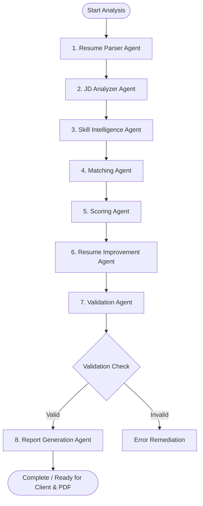

# ResumeIQ — Architecture & System Design

## 1. System Overview

**ResumeIQ** is an open-access, deterministic Agentic AI-powered ATS (Applicant Tracking System) Resume Analyzer. It evaluates resumes against job descriptions, computes explainable multi-component matching scores, categorizes candidate evidence, and generates actionable, fact-grounded resume improvements.

### Foundational Architectural Principles
1. **Zero Registration / Zero Authentication**: Completely open access. No logins, passwords, sessions, or role-based access controls (RBAC).
2. **Deterministic & Explainable Core**: Scores and gap analyses are calculated through deterministic algorithms (word-boundary token matching, Okapi BM25 relevance, local dense embeddings, interval timeline math, and degree hierarchy graphs). Generative LLMs are never used to compute ATS scores.
3. **Strict Fact Integrity**: Suggestions, bullet point rewrites, and skill gap identifications strictly preserve candidate truth without hallucinating unverified skills, employers, or metrics.
4. **Local Vector Embeddings**: Utilizes the `BAAI/bge-small-en-v1.5` dense embedding model running locally on CPU via `fastembed` with ONNX runtime. No mandatory external OpenAI or third-party inference APIs.
5. **Stateful Agent Workflow**: Orchestrated with a typed LangGraph `StateGraph` dividing analytical responsibilities across 8 specialized Python agents.

---

## 2. Component Topology

```text
┌─────────────────────────────────────────────────────────────────────────┐
│                           Client Web Browser                            │
│           (Next.js 16 App Router, Tailwind CSS, Recharts, Framer)       │
└────────────────────────────────────┬────────────────────────────────────┘
                                     │ HTTP / REST / JSON
                                     ▼
┌─────────────────────────────────────────────────────────────────────────┐
│                        Reverse Proxy / Ingress                          │
│                (Nginx: Port 80 -> Frontend:3000 / Backend:8000)         │
└──────────────────┬───────────────────────────────────┬──────────────────┘
                   │                                   │
                   ▼                                   ▼
┌──────────────────────────────────┐ ┌────────────────────────────────────┐
│      Next.js Frontend (SSR)      │ │        FastAPI Backend (v1)        │
│  - /analyze (Upload & JD Input)  │ │  - Security & RateLimit Middleware │
│  - /analyze/processing (Polling) │ │  - PDF/DOCX Parsing Engine         │
│  - /results/[id] (Score Gauge)   │ │  - LangGraph Multi-Agent Pipeline  │
│  - /improve/[id] (Diff Viewer)   │ │  - ReportLab PDF Generation Service│
└──────────────────────────────────┘ └─────────────────┬──────────────────┘
                                                       │
                           ┌───────────────────────────┴────────────────┐
                           ▼                                            ▼
┌───────────────────────────────────────────────┐ ┌───────────────────────────────┐
│          PostgreSQL 16 + pgvector             │ │         Redis 7 + Celery      │
│  - 12 Tables (Resumes, Jobs, Matches, Recs)   │ │  - Async Task Queue & Worker  │
│  - Local SQLite Fallback Engine               │ │  - Resilient In-Memory Cache  │
└───────────────────────────────────────────────┘ └───────────────────────────────┘
```

---

## 3. The 8 Specialized Agents (LangGraph Workflow)



1. **Resume Parser Agent**: Extracts text geometry using PyMuPDF and python-docx, detects boundaries across 9 section classes, and extracts structured items.
2. **JD Analyzer Agent**: Decomposes job requirements into required skills, preferred skills, minimum experience years, education levels, and responsibilities.
3. **Skill Intelligence Agent**: Normalizes extracted keywords against a 500+ skill canonical taxonomy, resolving synonyms (e.g., `PostgreSQL` = `postgres`, `React` = `reactjs`) and linking related technology stacks.
4. **Matching Agent**: Executes exact regex keyword matching, Okapi BM25 resume segment ranking, local dense semantic embedding cosine similarity, and overlapping date deduplication.
5. **Scoring Agent**: Applies the calibrated deterministic ATS formula:
   $$\text{ATS Score} = (\text{Keyword} \times 0.40) + (\text{Semantic} \times 0.25) + (\text{Experience} \times 0.20) + (\text{Project} \times 0.10) + (\text{Education} \times 0.05)$$
6. **Resume Improvement Agent**: Identifies weak action verbs and missing keywords, suggesting evidence-grounded bullet enhancements without hallucination.
7. **Validation Agent**: Enforces score consistency, checks evidence citations, and verifies that no mandatory skill omission is disguised.
8. **Report Generation Agent**: Formats database payloads, prepares real-time dashboard data, and provisions ReportLab PDF audit summaries.

---

## 4. Security & Isolation Boundaries

- **Untrusted File Isolation**: Uploaded files are assigned cryptographic UUID identifiers, validated against magic bytes (`%PDF-` and OpenXML zip signatures), size boundaries (max 10MB), and placed in an isolated upload storage directory with execute privileges revoked.
- **Sanitization Pipeline**: All raw parsed text undergoes regex neutralization stripping null bytes (`\x00`), HTML tags (`<script>`, `<iframe>`), and prompt injection sequences.
- **Sliding-Window Rate Limiting**: In-memory token sliding window limits requests to 60 req/min per IP address, responding with HTTP 429 and `Retry-After`.
- **Zero Credentials in Code**: Database and external service configuration rely exclusively on environment variables (`.env`).

