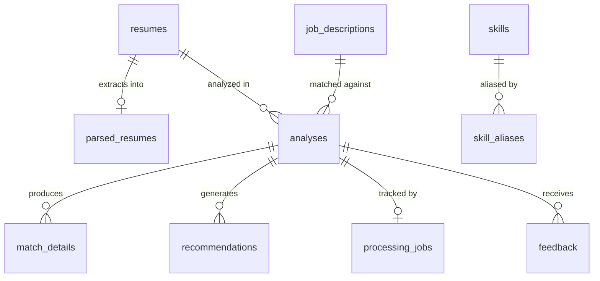

# ResumeIQ — Database Schema Specification

ResumeIQ uses **SQLAlchemy 2.0** ORM supporting both enterprise **PostgreSQL (with pgvector)** and zero-friction local **SQLite**.

The database architecture consists of 12 distinct relational tables designed for analytical auditability, speed, and privacy.

---

## 1. Entity-Relationship Overview

---

## 2. Table Specifications

### 1. `resumes`
Stores untrusted uploaded resume file metadata and extracted raw text.
- `id` (VARCHAR(36), PK): UUID v4 identifier.
- `filename` (VARCHAR(255), NOT NULL): Original uploaded filename.
- `file_type` (VARCHAR(10), NOT NULL): File extension (`pdf` or `docx`).
- `file_size` (INTEGER, NOT NULL): File size in bytes.
- `file_path` (VARCHAR(512), NOT NULL): Sandboxed storage path in `/uploads`.
- `raw_text` (TEXT, NULL): Sanitized text extracted from the document.
- `is_processed` (BOOLEAN, DEFAULT FALSE): Parser completion status.
- `created_at` (TIMESTAMP WITH TIME ZONE, DEFAULT utcnow).

### 2. `parsed_resumes`
Holds structured entities parsed from candidate resumes.
- `id` (VARCHAR(36), PK): UUID v4 identifier.
- `resume_id` (VARCHAR(36), FK -> `resumes.id`, UNIQUE, NOT NULL).
- `contact_info` (JSON, DEFAULT {}): `{name, email, phone, linkedin, github, portfolio}`.
- `summary` (TEXT, NULL): Extracted professional summary statement.
- `skills` (JSON, DEFAULT []): Extracted canonical candidate skills.
- `work_experience` (JSON, DEFAULT []): Array of `{company, role, start_date, end_date, bullets}`.
- `education` (JSON, DEFAULT []): Array of `{institution, degree, field_of_study, graduation_year}`.
- `projects` (JSON, DEFAULT []): Array of `{name, description, technologies}`.
- `certifications` (JSON, DEFAULT []): Array of certification titles and issuers.
- `languages` (JSON, DEFAULT []): Spoken and written language competencies.
- `created_at` (TIMESTAMP WITH TIME ZONE, DEFAULT utcnow).

### 3. `job_descriptions`
Target job description specifications.
- `id` (VARCHAR(36), PK): UUID v4 identifier.
- `title` (VARCHAR(255), NULL): Target job role title.
- `company` (VARCHAR(255), NULL): Hiring entity name.
- `raw_text` (TEXT, NOT NULL): Full sanitized JD text content.
- `extracted_data` (JSON, DEFAULT {}): `{required_skills, preferred_skills, experience_years_required, education_required, responsibilities, qualifications}`.
- `created_at` (TIMESTAMP WITH TIME ZONE, DEFAULT utcnow).

### 4. `analyses`
Root record of an ATS matching run.
- `id` (VARCHAR(36), PK): UUID v4 identifier.
- `resume_id` (VARCHAR(36), FK -> `resumes.id`, NOT NULL).
- `job_id` (VARCHAR(36), FK -> `job_descriptions.id`, NOT NULL).
- `overall_score` (FLOAT, DEFAULT 0.0): Final computed ATS score (0.0 to 100.0).
- `keyword_score` (FLOAT, DEFAULT 0.0): Exact and related skill match score.
- `semantic_score` (FLOAT, DEFAULT 0.0): Dense vector BGE-small cosine similarity.
- `experience_score` (FLOAT, DEFAULT 0.0): Chronological tenure ratio.
- `project_score` (FLOAT, DEFAULT 0.0): Technical project relevance score.
- `education_score` (FLOAT, DEFAULT 0.0): Degree hierarchy qualification score.
- `scoring_breakdown` (JSON, DEFAULT {}): Score breakdown with weights used.
- `status` (VARCHAR(20), DEFAULT 'pending'): Status (`pending`, `processing`, `completed`, `failed`).
- `error_message` (TEXT, NULL): Error diagnostics if processing failed.
- `created_at` (TIMESTAMP WITH TIME ZONE, DEFAULT utcnow).
- `completed_at` (TIMESTAMP WITH TIME ZONE, NULL).

### 5. `match_details`
Per-skill granular evidence ledger.
- `id` (VARCHAR(36), PK): UUID v4 identifier.
- `analysis_id` (VARCHAR(36), FK -> `analyses.id`, NOT NULL).
- `skill_name` (VARCHAR(100), NOT NULL): Canonical skill evaluated.
- `match_type` (VARCHAR(20), NOT NULL): `exact`, `related`, `missing`.
- `evidence_type` (VARCHAR(50), NOT NULL): `demonstrated_in_experience`, `demonstrated_in_projects`, `mentioned_in_skills`, `mentioned_in_certifications`, `missing`.
- `confidence` (FLOAT, DEFAULT 0.0): Match confidence (0.0 to 1.0).
- `context_snippet` (TEXT, NULL): Verified sentence excerpt from resume proof.
- `is_mandatory` (BOOLEAN, DEFAULT FALSE): True if listed as mandatory in JD.

### 6. `recommendations`
Concrete resume enhancement suggestions.
- `id` (VARCHAR(36), PK): UUID v4 identifier.
- `analysis_id` (VARCHAR(36), FK -> `analyses.id`, NOT NULL).
- `category` (VARCHAR(50), NOT NULL): `weak_bullet`, `missing_keyword`, `structure`, `summary`.
- `original_text` (TEXT, NULL): Original resume sentence (if applicable).
- `suggested_text` (TEXT, NOT NULL): Factual, strengthened suggestion.
- `reasoning` (TEXT, NOT NULL): ATS impact rationale.
- `priority` (VARCHAR(10), DEFAULT 'medium'): `high`, `medium`, `low`.

### 7. `processing_jobs`
Real-time pipeline execution tracking.
- `id` (VARCHAR(36), PK): UUID v4 identifier.
- `analysis_id` (VARCHAR(36), FK -> `analyses.id`, NOT NULL).
- `status` (VARCHAR(20), DEFAULT 'in_progress'): `in_progress`, `completed`, `failed`.
- `stage` (VARCHAR(100), DEFAULT 'Queued'): Current agent execution stage.
- `progress_percentage` (INTEGER, DEFAULT 0): Completion percent (0 to 100).
- `error` (TEXT, NULL).
- `updated_at` (TIMESTAMP WITH TIME ZONE, DEFAULT utcnow).

### 8. `skills`
Curated technical skill dictionary.
- `id` (INTEGER, PK, AUTOINCREMENT).
- `name` (VARCHAR(100), UNIQUE, NOT NULL): Canonical skill name.
- `category` (VARCHAR(50), NOT NULL): `languages`, `frameworks`, `cloud`, `databases`, `devops`, `tools`.
- `description` (TEXT, NULL).

### 9. `skill_aliases`
Synonym and abbreviation mappings.
- `id` (INTEGER, PK, AUTOINCREMENT).
- `skill_id` (INTEGER, FK -> `skills.id`, NOT NULL).
- `alias` (VARCHAR(100), UNIQUE, NOT NULL): E.g., `postgres` -> `PostgreSQL`, `k8s` -> `Kubernetes`.

### 10. `scoring_weights`
Versioned scoring parameters.
- `id` (INTEGER, PK, AUTOINCREMENT).
- `version` (VARCHAR(20), UNIQUE, NOT NULL): E.g., `v1.0.0-heuristic`.
- `keyword_weight` (FLOAT, DEFAULT 0.40).
- `semantic_weight` (FLOAT, DEFAULT 0.25).
- `experience_weight` (FLOAT, DEFAULT 0.20).
- `project_weight` (FLOAT, DEFAULT 0.10).
- `education_weight` (FLOAT, DEFAULT 0.05).
- `is_active` (BOOLEAN, DEFAULT TRUE).

### 11. `system_logs`
Operational events and agent trace logs.
- `id` (VARCHAR(36), PK).
- `level` (VARCHAR(10), NOT NULL): `INFO`, `WARNING`, `ERROR`.
- `agent_name` (VARCHAR(50), NULL).
- `message` (TEXT, NOT NULL).
- `metadata` (JSON, DEFAULT {}).
- `created_at` (TIMESTAMP WITH TIME ZONE, DEFAULT utcnow).

### 12. `feedback`
User feedback for scoring calibration.
- `id` (VARCHAR(36), PK).
- `analysis_id` (VARCHAR(36), FK -> `analyses.id`, NOT NULL).
- `rating` (INTEGER, NOT NULL): 1 to 5.
- `comments` (TEXT, NULL).
- `created_at` (TIMESTAMP WITH TIME ZONE, DEFAULT utcnow).
